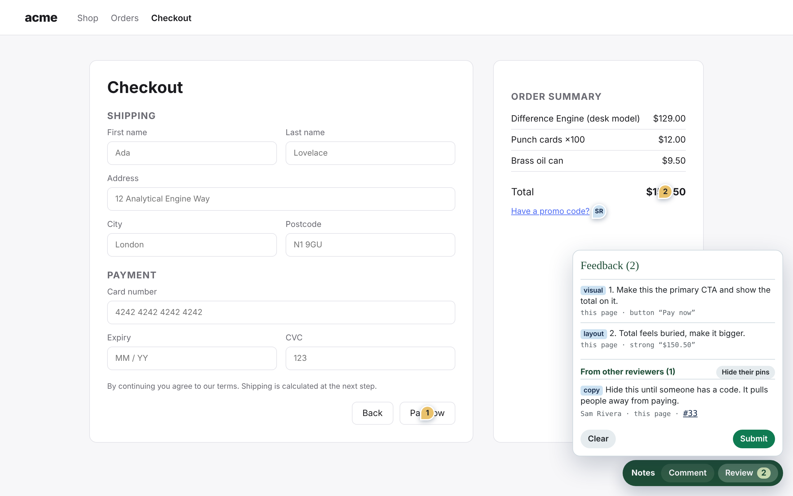
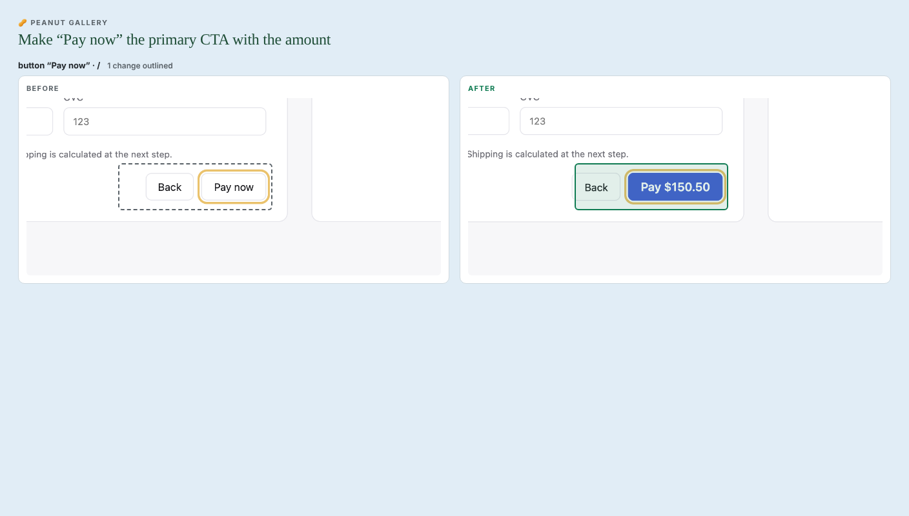
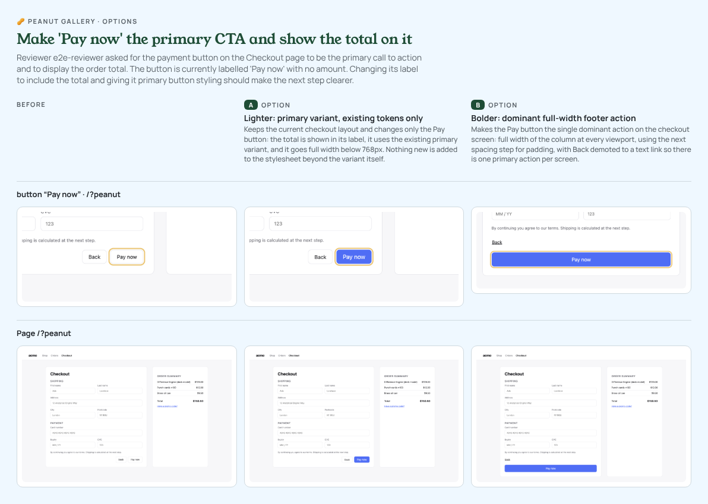

# Peanut Gallery 🥜

> Where feedback actually ships.

**[Try the live demo →](https://pixelatlarge.github.io/peanut-gallery/)**

https://github.com/user-attachments/assets/6f9dd8ca-1b8b-4670-8693-3aa33aff28fa

Annotate your prototype or web app → feedback lands in GitHub Issues → Claude turns it into concrete proposals, implements each on a branch, captures **before / after**, asks reviewers which they prefer, and opens a PR per change.

```
reviewer (browser)            your repo (CLI)                       GitHub
──────────────────            ───────────────                       ──────
click element, write note ─▶  issue w/ selector+text+page   ◀──── peanut-gallery:feedback
                              peanut-gallery review
                                pull      ─ parse issues
                                interpret ─ Claude clusters → proposals
                                apply     ─ Agent SDK edits on a branch
                                          ─ Playwright before/after shots
                                          ─ push, open PR  ───────────▶ PR + comparison
                                          ─ comment on issue ─────────▶ "👍 after / 👎 before?"
                                votes     ─ tally reactions/replies → label accepted/rejected
```

| Reviewers annotate the live page | Each change ships with a before / after | Not sold? Generate options |
| --- | --- | --- |
|  |  |  |

Three packages, one CLI:

| package | what it is |
| --- | --- |
| `@pixelatlarge/peanut-gallery-widget` | Drop-in annotation layer (script tag or React). Shadow-DOM UI, pins attached to DOM elements, persists across pages, submits to GitHub. |
| `@pixelatlarge/peanut-gallery-relay` | Optional one-file serverless function that creates issues with a server-held token (one-click submit, reviewers don't need GitHub). |
| `peanut-gallery` (CLI) | Runs in your repo: `init · pull · interpret · apply · review · votes · compare`. |
| `@pixelatlarge/peanut-gallery-core` | Shared types, robust element anchoring, issue body format. |

**What you need — and what you don't**

- **No local AI.** Nothing runs a model on anyone's machine; every AI step is a Claude API call. No GPU, no downloads.
- **Reviewers** need a browser. That's it.
- **The builder** (whoever runs the CLI) needs Node ≥ 20, git, the `gh` CLI (authenticated), a Chromium for screenshots (`npx playwright install chromium`, or `PEANUT_GALLERY_BROWSER=/path/to/chrome`), and Claude credentials: either an existing **Claude Code login** (`claude login` — picked up automatically) or `ANTHROPIC_API_KEY`.
- **Cost:** interpretation is pennies (Haiku). Each implemented proposal is an agentic coding session — about **$1 for a small change** with Sonnet (measured: ~$0.90 each on a small prototype), more on bigger codebases; the CLI prints an estimate before it starts and the actual spend after. `variants -n 3` ≈ three proposals.

---

## Try the demo

The demo is live at **https://pixelatlarge.github.io/peanut-gallery/** and redeploys on every push to `main`. To build it yourself, `npm run demo:build` builds a static demo into `demo/dist`: a sample checkout with the real widget, a live preview of the GitHub issue your notes create, and the before/after, vote and options steps from a recorded real-Claude run. Deploy that folder to any static host (GitHub Pages, Netlify, Vercel). Nothing in the demo calls Claude or GitHub.

## 1. Add the widget to your prototype or app

**Script tag (any page):**

```html
<script src="https://unpkg.com/@pixelatlarge/peanut-gallery-widget/dist/peanut-gallery.global.js"
        data-repo="owner/prototype-repo"
        data-activation="query"></script>
```

Open the page with `?peanut` in the URL. A toolbar appears: **Comment** → click any element → write a note (optionally tag it bug / copy / layout / visual / flow / question / praise). Pins are numbered and re-attach to their element on reload, resize and reorder. **Review** lists everything; **Submit to GitHub** opens a prefilled issue.

**React:**

```tsx
import { PeanutGallery } from '@pixelatlarge/peanut-gallery-widget/react';

{import.meta.env.VITE_PEANUT_GALLERY && <PeanutGallery repo="owner/prototype-repo" />}
```

**Programmatic:**

```ts
import { init } from '@pixelatlarge/peanut-gallery-widget';
init({ repo: 'owner/prototype-repo', relayUrl: 'https://…/api/peanut-gallery', author: 'Anna' });
```

| option | default | notes |
| --- | --- | --- |
| `repo` | — | `owner/name` |
| `mode` | `auto` | `issue-url` (zero infra, reviewer needs GitHub access) · `relay` · `auto` = relay if `relayUrl` set |
| `relayUrl` | — | see §2 |
| `relayKey` | — | sent as `x-peanut-gallery-key`, for a relay with `sharedKey` (`data-relay-key`) |
| `showOthers` | `true` | show other reviewers' notes when the relay shares them (`data-show-others="false"` to hide) |
| `activation` | `always` | `query` = only with `?peanut` (sticky per tab) |
| `author` | asks once | reviewer name on the issue |
| `labels` | `peanut-gallery, peanut-gallery:feedback` | |
| `kinds` | all seven | which tags to offer |
| `theme` | `"cool"` | `"cool"` or `"warm"`, or override any colour or font role, e.g. `{ primary: '#5b3df5', fontBody: 'Inter, sans-serif' }`, optionally on a preset (`{ preset: 'warm', … }`). `data-theme="warm"` on the script tag |
| `loadFonts` | `false` | load Manrope, Young Serif and JetBrains Mono from Google Fonts (`data-load-fonts="true"` on the script tag) |
| `recordTyping` | `true` | keep what reviewers type and choose, so screenshots can replay it (private fields never are; see below). `data-record-typing="false"` on the script tag |
| `onSubmit` | — | handle submission yourself (your backend, a demo); overrides `mode`. Resolve to clear the notes, return `{ keep: true }` to keep them, throw to show an error |
| `session` | — | start from these notes instead of the ones saved in the browser |

### Theming

The widget and the generated comparison pages share one theme: a deep forest toolbar, emerald actions, sunny-yellow pins and outlines, carbon text on cool sea-glass and gull neutrals, with Young Serif headings and Manrope UI text. Prefer warm linen neutrals? `theme: "warm"`. Every role (`primary`, `toolbar`, `accent`, `highlight`, `chip`, `bg`, `fontBody`, …, see `packages/core/src/theme.ts`) can be overridden — `theme` in `init()` for the widget, `theme` in `peanut-gallery.config.json` for the CLI's before/after and options pages:

```jsonc
{ "theme": { "primary": "#5b3df5", "toolbar": "#1b1340", "accent": "#ffcc4d" } }
```

The widget never loads webfonts on its own; it uses the theme fonts if the page already has them (or with `loadFonts: true`) and falls back to the system UI font.

### How anchoring works

Each note stores a CSS selector that prefers stable hooks (`data-testid`, `id`, `aria-label`, non-hashed classes, then a structural path), the element's text, tag, nearby heading, document rect and the click offset. On resolve it tries selector → selector + text → same-tag text search → stored coordinates, and reports a confidence. The same code runs in the widget and in the CLI's Playwright screenshots, so the "after" close-up finds the element even when the fix changed its text or moved it. Add `data-testid`s to important elements for best results.

**Single-page apps.** Pins follow client-side navigation (React Router, Next, Vue Router, hash routes) and redraw when the app re-renders, so a note on a list that loads after the page still lands on its item. A note on something that isn't on screen right now, like a closed modal, hides its pin until the element comes back; it stays in the notes list. Each note remembers its route, ignoring the `?peanut` switch and tracking parameters.

**Notes inside modals, search results and forms.** Each note also keeps the last few things the reviewer did on that page before leaving it: what they clicked, what they typed, options they chose, and Enter. The issue shows them ("Reached by: typing “lamp” into “Search” → pressing Enter"), and the agent is told how the element is reached. When the element isn't on the freshly loaded page, or the reviewer typed to get there, the before/after screenshots do the same steps first, so the comparison shows the open dialog or the search results.

**Private fields are never recorded.** Passwords, card and bank details, codes, email, phone, name, address and birthday are kept as "filled in “Email”", without what was typed. Screenshots type a harmless stand-in (`reviewer@example.com`) or skip the field. To keep any other field out, mark it `data-peanut-private`. Markup that session-replay tools already use also works: `data-private`, `.fs-exclude`, `data-hj-suppress`, `.sentry-mask`. Set `recordTyping: false` in the widget to keep clicks only. Set `"screenshot": { "replayClicks": false }` if replaying steps against your dev server could have side effects.

**Notes left on a phone get phone-size screenshots.** Each note records the reviewer's screen size. When it's phone size, the issue says so, the agent is told, and the before/after shots for that note are taken at phone size (390×844, a touch phone browser) instead of desktop, plus the page at both sizes. That covers things that only exist on phones, like a sticky bottom bar or a hamburger menu. To shoot everything at both sizes, set `"screenshot": { "phone": true }` (or a size, `{ "width": 375, "height": 667 }`). `false` keeps desktop only.

**What changed is outlined.** Each before/after pair is compared pixel by pixel and the areas that look different are outlined: solid on after, dashed on before. That holds on the comparison page (with a switch to hide the outlines) and on the PR image. Close-ups are lined up first, so when an element grows or shrinks, only what really changed gets outlined, not everything around it that moved. When a close-up shows **no visible change**, it's flagged, and when no screenshot shows a difference, the PR says so: the change may not have taken effect. To turn outlines off, set `"screenshot": { "highlight": false }`.

## 2. (Optional) Relay for one-click submission

The browser can't hold a GitHub token. If reviewers shouldn't need GitHub accounts, deploy the relay — it's one function that validates the payload and creates the issue.

```ts
// api/peanut-gallery.ts (Vercel) — templates for Cloudflare, Netlify and Node are in packages/relay/templates
import { createRelayHandler } from '@pixelatlarge/peanut-gallery-relay';
export default createRelayHandler({
  githubToken: process.env.PEANUT_GALLERY_TOKEN!,        // fine-grained PAT, Issues: write on that one repo
  repo: process.env.PEANUT_GALLERY_REPO!,
  allowedOrigins: ['https://proto.example.com'],      // CORS
  sharedKey: process.env.PEANUT_GALLERY_KEY,             // optional; give the widget the same value as relayKey
  shareNotes: true,                                      // optional: reviewers see each other's notes
});
```

Then `data-relay-url="https://…/api/peanut-gallery"` on the widget (and `data-relay-key` if you set `sharedKey`).

**Reviewers see each other's notes** when the relay has `shareNotes: true`. The widget pins the notes from open feedback issues for that site next to the reviewer's own, with the other reviewer's initials. Tapping one opens it read-only, with a link to its issue, and the panel lists them, with a switch to hide their pins. Pins on the same element fan out so each can be opened, and they let clicks through while you pick an element to comment on. The relay caches what it reads from GitHub for 30 seconds (`notesCacheSeconds`) and shows a new submission straight away, before GitHub's issue list catches up. Anyone allowed to call the relay can read the notes, so leave it off when the prototype is public and the feedback shouldn't be. `showOthers: false` hides them in one widget.

## 3. Run the loop in your repo

```bash
npm i -D peanut-gallery
npx peanut-gallery init          # writes peanut-gallery.config.json, creates labels, prints the widget snippet
npx peanut-gallery review        # pull → interpret → confirm → apply
```

`peanut-gallery.config.json`:

```jsonc
{
  "repo": "owner/prototype-repo",
  "prototypeUrl": "https://proto.example.com",   // "before" shots come from here; omit to use a local base-branch server
  "baseBranch": "main",
  "dev": { "command": "npm run dev -- --port {port}", "port": 4310 },
  "sourceHints": ["src/**"],                     // where the agent should look
  "agentNotes": "Tailwind + shadcn. Use tokens from src/theme.ts.",
  "models": { "interpret": "claude-haiku-5-5", "apply": "claude-sonnet-5-5" },   // try claude-opus-5-5 for apply on big codebases
  "budget": 10,                                   // USD cap per apply/review/variants run; --budget overrides
  "theme": "cool",                                // "cool" | "warm", or colour/font overrides for comparison pages
  "screenshot": { "width": 1280, "height": 800 }
}
```

### Use your design system

Tell the agent what to build with, and it reads those files before every change, uses your tokens instead of raw values, and reuses your components. `init` pre-fills token files and design docs it finds.

```jsonc
"designSystem": {
  "packages": ["@acme/ui"],                        // import from these instead of building new components
  "tokens": ["src/styles/tokens.css", "tailwind.config.ts"],
  "components": ["src/components/**"],
  "docs": ["docs/design-system.md"],
  "rules": "One primary action per screen. Sentence case for labels.",
  "allowEdits": false                               // default: token and doc files are protected
}
```

- **Proposals and options stay inside the system.** Interpreting feedback and generating options get a short summary, so a "bolder" option uses an existing variant instead of inventing a colour.
- **The system isn't redefined to satisfy one comment.** Token and doc files are protected from edits; if a change needs something the system lacks, the agent uses the closest option and says what's missing in the PR. Set `allowEdits: true` if this repo *is* the design system.
- **CLAUDE.md is read as text.** `CLAUDE.md`, `AGENTS.md` and `.claude/CLAUDE.md` (as committed on the base branch) go to the agent as the maintainers' guidance. Their settings, hooks and permissions are still never loaded. Use `"projectGuidance": ["docs/conventions.md"]` for other files, or `false` to skip.

**Checks.** Run your own tools on each change before its PR opens — a drift checker, linter or accessibility scan. Results appear in the PR; a failing `required` check opens it as a draft.

```jsonc
"checks": [
  { "name": "Design-system drift", "command": "npx your-drift-checker", "required": true },
  { "name": "Lint", "command": "npm run lint -- $PEANUT_GALLERY_CHANGED_FILES", "timeoutSec": 60 }
]
```

Two checks are built in, both on by default and report-only:

- **Description matches the code.** After the agent's change, a second, cheap Claude pass (`models.interpret`) reads the diff next to the plan, the agent's "What changed" summary and the reviewer requests. It lists what doesn't line up: things described but not in the code, changes in the code nobody mentioned, and reviewer requests not addressed. Findings show in the PR under Checks, with a warning under "What changed", so a reviewer doesn't take the description on trust. Lockfiles and peanut-gallery's own files are left out. `"builtinChecks": { "description": "required" }` opens mismatched PRs as drafts; `false` turns it off.
- **Undefined CSS classes** flags classes a change adds to markup that no stylesheet defines, i.e. edits with no visible effect. It skips Tailwind/UnoCSS projects. `"builtinChecks": { "undefinedClasses": "required" }` opens such PRs as drafts; `false` turns it off.

Commands run in the change's worktree with `PEANUT_GALLERY_CHANGED_FILES` (newline-separated), `PEANUT_GALLERY_BASE` and `PEANUT_GALLERY_PROPOSAL` set. They come from your config, which the agent can't edit.

### Cost guardrails

- `apply --dry-run` / `review --dry-run` print a per-proposal estimate and exit. It starts from defaults (small ≈ $1, medium ≈ $2, large ≈ $4) and, after two runs, learns from what your own runs cost (`.peanut-gallery/runs.json`, same agent model preferred, median so one odd run doesn't skew it). Failed or discarded runs still count toward `--budget`.
- `--budget 5` (or `budget` in config) stops **before** starting a proposal that would push spend over the cap, so a run never surprises you. Already-built proposals are kept.
- Per-stage models: cheap model for triage and option generation, stronger model for the code. A single `model` still works as a shortcut for both.

### Commands

| command | does |
| --- | --- |
| `init [--action]` | Write `peanut-gallery.config.json` and create the labels. `--action` also adds the GitHub Actions workflow (on its own if you're already set up). |
| `pull [--all] [--new] [--issue n…]` | Fetch issues labelled `peanut-gallery:feedback`, parse the embedded session → `.peanut-gallery/feedback.json`. `--new` skips feedback that already has a proposal; `--issue` limits it to certain issues. |
| `interpret` | Claude groups comments into independent proposals (title, summary, agent spec, affected pages/elements, effort, confidence) → `.peanut-gallery/proposals.json`. Edit this file if you disagree. |
| `apply [--only id…] [--draft] [--no-pr] [--no-screenshots] [--no-comment] [--include-contested]` | Per proposal: git worktree from base → Agent SDK implements (edits auto-accepted; shell limited to npm/npx/pnpm/yarn) → commit → start the dev server in the worktree → Playwright before/after (close-ups of each annotated element + full page) → `compare.html` (side-by-side / slider / toggle) + `summary.png` committed on the branch → push → PR with the image → comment on each source issue asking for a vote. |
| `variants <id> [-n 1–3] [--note "…"]` | Not happy with the before/after? Generate 1–3 genuinely different directions for the same proposal (Claude is told what was already tried and your note), build each on its own branch + PR, and post one combined **before / A / B / C** image to the issue. Reviewers reply with a letter; `votes` tallies it. Re-run with a new note for another round (labels become A2, B2…). |
| `decide <id> <n>` | Resolve a contested proposal by picking one of its positions, then `apply --only <id>`. |
| `review [-y] [--new] [--issue n…] [--dry-run]` | The three above in sequence with a confirmation. |
| `votes [--label] [--local] [--keywords]` | Tallies 👍/❤️/🚀 (after) vs 👎/😕 (before) on the comparison comments, plus replies. Plain replies ("after", "B") are read with keywords; Claude reads the rest (see below). It finds comparisons from your local history and from the comments on GitHub, so it works on any machine. `--label` applies `peanut-gallery:accepted` / `rejected` and comments on the PR with the verdict and what reviewers asked for. `--keywords` never calls Claude. |
| `compare <id>` | Opens the interactive before/after page for a proposal locally. |

### Run it automatically (GitHub Action)

Let the loop run without anyone's laptop:

```bash
npx peanut-gallery init --action      # writes .github/workflows/peanut-gallery.yml
claude setup-token                     # then: gh secret set CLAUDE_CODE_OAUTH_TOKEN
```

Commit `peanut-gallery.config.json` and the workflow. From then on:

- **New feedback** (an issue labelled `peanut-gallery:feedback`) is turned into pull requests with before/after screenshots, and the comparison is posted back on the issue.
- **Replies** on an issue with a proposal are tallied as votes, and the PR gets a verdict when it changes.
- **Every 6 hours**, and whenever you run it from the Actions tab, it catches anything missed and tallies votes.

Or add the step to a workflow of your own:

```yaml
- uses: actions/checkout@v5
- uses: PixelAtLarge/peanut-gallery@v0
  with:
    claude-code-oauth-token: ${{ secrets.CLAUDE_CODE_OAUTH_TOKEN }}   # or anthropic-api-key
    budget: 5          # most to spend on the coding agent per run, in USD
    # mode: auto       # review, votes or both; auto picks from the event
    # install-command: auto   # your install command, for the dev server used in screenshots
```

Good to know:

- **Who can start a run:** the workflow only acts on issues with the feedback label, and only people who can triage your repo can add labels. The relay adds the label with its own token. Replies from anyone are counted as votes, but votes never start the coding agent.
- **Letting it open pull requests:** repositories block workflows from opening pull requests by default. `init --action` turns on "Allow GitHub Actions to create and approve pull requests" for you when your GitHub login can. Otherwise it's under Settings → Actions → General → Workflow permissions.
- **Your other checks:** pull requests opened with the default `GITHUB_TOKEN` don't start your other workflows, such as CI. Pass a personal access token or a GitHub App token as `github-token` if you need them to.
- **Matching versions:** the action builds the CLI from its own version of this repository, so the two always match.
- **Screenshots in CI:** they work as they do locally. The runner installs your dependencies and starts your dev server, so your app needs to start without production secrets. Run history is cached between runs, so cost estimates keep improving.

### Screenshots from preview deployments

If your host builds a preview of every pull request (Vercel, Netlify, Cloudflare Pages, Render…), take the "after" screenshots from it instead of a local dev server:

```json
"preview": {
  "environment": "Preview",
  "headers": { "x-vercel-protection-bypass": "${VERCEL_AUTOMATION_BYPASS_SECRET}", "x-vercel-set-bypass-cookie": "true" }
}
```

`apply` pushes the branch and opens the pull request, waits for the host's preview of that exact commit, takes "after" from it, and then adds the comparison to the PR and the issues. "Before" comes from `prototypeUrl`, or your production deployment, or the local dev server, in that order (`"before": "local"` forces the dev server).

- **Finding the preview:** hosts that integrate with GitHub report each preview as a GitHub deployment with its URL, so nothing else is needed. `environment` narrows it down if you have several. For a host that doesn't report deployments, give a pattern instead: `"url": "https://deploy-preview-{pr}--mysite.netlify.app"` (`{pr}`, `{branch}`, `{branchSlug}`, `{sha}`, `{shortSha}`).
- **Protected previews:** `headers` are sent only to the preview, never to fonts or other sites. `${NAME}` is read from the environment, so secrets stay out of the config file. In GitHub Actions, pass them as `env` from your secrets.
- **When it doesn't show up:** after `timeoutSeconds` (default 600), it falls back to the local dev server if you have one, or opens the PR without screenshots and says why.
- **In GitHub Actions:** the workflow from `init --action` already has the `deployments: read` permission this needs.

`true` turns it on with the defaults: `"preview": true`.

### Agreement and conflict

`interpret` doesn't just cluster — it records **who** asked for each change and flags **disagreement**:

- Every proposal carries `support` (distinct reviewers, comment count), computed from the annotations rather than guessed by the model. PRs and issue comments open with it: _"3 reviewers agree — anna, bob, cy (5 comments)"_ vs _"requested by anna"_.
- When comments about the same element pull in different directions, the proposal is marked `contested` with each position (summary, its own implementable instructions, which reviewers hold it) and a recommendation. `apply` **skips** contested proposals and posts a "⚑ Decision needed" comment on the source issues listing the options. Once the team picks one, `peanut-gallery decide <id> <n>` rewrites the proposal and `apply --only <id>` builds it. `--include-contested` applies the recommendation instead, if you'd rather see it built than discussed.

### Not sold on the "after"? Ask for options

```bash
peanut-gallery variants pr_3f2a --note "first attempt was too heavy — one lighter, one bolder" -n 2
```

Each option is a real branch with a real PR, so picking one is a merge, not a re-brief. Options are reviewed in one grid rather than a chain of PRs, and "none, because…" is a legitimate answer that seeds the next round.

Everything is reviewable and reversible: proposals are a JSON file you can edit before applying, each change is its own branch/PR, and the agent never touches `main`.

### The reviewer's second look

After `apply`, each feedback issue gets a comment with the side-by-side image, the PR link and a vote prompt. Reviewers react or reply in plain language; `votes` reads it back.

**How replies are read.**
- **Plain votes** ("after", "👍 ship it", "B please") are read with keywords.
- **Anything more goes to Claude** (`models.interpret`, a small, cheap model): "after, but keep the old green", "neither, I'd rather see the total", a question, or a reply on an issue with several proposals that doesn't say which one it means.
- **One proposal per reply.** Claude decides which proposal the reply is about, counting it only once. "Neither" counts against shipping that version, and a question isn't a vote.
- **Requests are kept.** Anything else the reviewer asks for is kept in their words, listed in the PR verdict ("Reviewers also asked for: keep the old green") and in the Action's job summary.
- **Each reply is read once.** Readings are cached in `.peanut-gallery/vote-readings.json` (the Action keeps it between runs), so a reply isn't read twice. An edited reply is read again.
- **Without Claude** (no login, or `"votes": { "reader": "keywords" }`), keywords read every reply. A reply that doesn't say which proposal it means counts for the nearest one above it. For a live "after", point reviewers at the PR's preview deployment (Vercel/Netlify/Pages) with `?peanut` — they can annotate the new version and the loop runs again.

## Security model

Reviewer comments are untrusted input, and they reach an AI agent that edits your code, so the agent is locked down by default:

- **No shell, network or sub-agents.** The agent can only read, search and edit files. Every tool call — including reads the SDK would normally auto-allow — passes through a policy check (`packages/cli/src/policy.ts`).
- **Edits stay inside the change's own git worktree**, and never touch git internals, `.github/` (CI), `.claude/`, `node_modules/`, Peanut Gallery's own config, `.npmrc`, secrets (`.env*`, keys, credentials), dependency manifests (`package.json`, lockfiles) or design-system token/doc files. Paths are checked after resolving symlinks, so a link in the repo can't point the agent elsewhere.
- **Repo and user settings aren't loaded** into the agent (no hooks, MCP servers or permission rules from disk). CLAUDE.md is passed as plain text only.
- **Comments are marked untrusted** in both AI steps; requests to run commands, add dependencies, scripts, tracking or CI changes are skipped as out of scope.
- **Post-run audit:** if a change touched a protected file anyway, it is discarded and never becomes a PR. Blocked tool calls are listed in the PR body.
- **Humans merge.** Every change is a normal PR on its own branch.

Opt-ins, if your project needs them, in `peanut-gallery.config.json`:

```jsonc
"agent": {
  "allowCommands": ["npm run lint", "npx prettier --write"],  // exact prefixes; no chaining, pipes or redirects
  "allowDependencyChanges": false,
  "protectedPaths": ["src/legal/", "src/brand/**"]   // prefixes or globs
}
```

## Development

```bash
npm i
npm run build
npm test
node scripts/e2e-smoke.mjs     # drives the widget in a real browser + runs the screenshot/compare pipeline (no AI/GitHub needed)
SANDBOX=you/empty-repo node scripts/e2e-github.mjs            # full loop against a real GitHub repo; AI calls stubbed
SANDBOX=you/empty-repo node scripts/e2e-github.mjs --real-ai  # same, with real Claude (claude login or ANTHROPIC_API_KEY)
SANDBOX=you/empty-repo node scripts/e2e-react.mjs             # the loop on a React + Vite app (routes, async data, a modal), on a react-app branch
```

`examples/vanilla-prototype` is a static checkout page with the widget wired up (`npm run example`, then open `http://localhost:5173/?peanut`). `examples/react-app` is a small React 19 + React Router + Vite shop with an async cart and a confirm dialog, used by `e2e-react.mjs`.

## Roadmap / known limits

- `issue-url` mode truncates very long sessions to fit GitHub's URL limit (~40 short notes); use the relay for big sessions.
- Phone-size shots use one phone size per run (`screenshot.phone`); tablets get the desktop size.
- Apps that need a login: set `prototypeUrl` to a local server, or extend `captureShots` with a storage state. Protected preview deployments already work, through `preview.headers`.
- Replayed steps stay on one page: steps reset when the URL changes (the URL usually carries that state, e.g. `?q=lamp`). States that need a real password or card number can't be replayed; typing into rich-text editors (`contenteditable`) isn't recorded yet.
- Relay-mode shared pins (see teammates' comments while annotating, +1 instead of re-writing) are the planned next pass.
- `variants` publishes the combined image to a `peanut-gallery/assets` branch so it can be embedded in issue comments; delete that branch any time.
- Framework-aware source mapping (React component names/`data-source` attributes) would tighten the agent's edits further.
